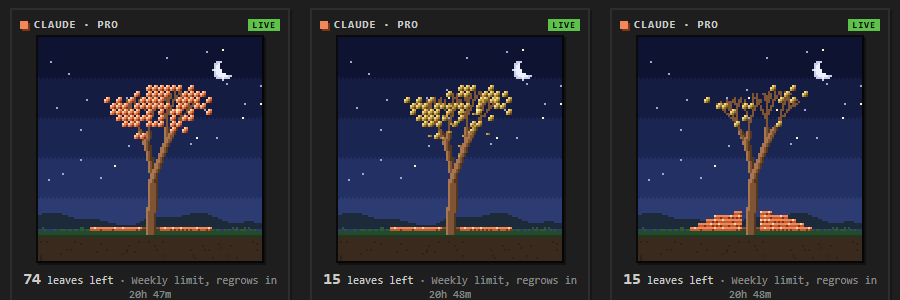

# Pixel Quota Left

One pixel-art tree **per AI coding plan**. Leaves on the tree = quota left.



- **1 leaf = 1% left** of the plan's *binding* limit (whichever of the 5-hour / weekly windows has less left).
- Used quota lies on the ground as a **leaf pile**. When usage rises, leaves fall into it.
- When a window resets, the pile clears and **leaves grow back**.
- At ≤ 20% left the leaves wilt to yellow.
- Every limit (including model-scoped ones, e.g. "Weekly · Opus") has its own bar below the tree.

## Where the numbers come from

Plans are metered as **% of rolling windows**, not as a token count, so "left" is shown in %.

| Plan | Source | Credential used |
|---|---|---|
| Claude (Pro / Max / …) | `GET https://api.anthropic.com/api/oauth/usage`, the endpoint behind Claude Code's `/usage` | Claude Code login token from `~/.claude/.credentials.json` (macOS: keychain) |
| ChatGPT / Codex (Plus / Pro / …) | `GET https://chatgpt.com/backend-api/wham/usage`, used by the Codex CLI | Codex login token from `~/.codex/auth.json` |

⚠️ Both endpoints are **undocumented** and may change without notice.

- Each token is sent **only to the provider that issued it**. Nothing else leaves your machine.
- The extension **never refreshes tokens itself**, because that would rotate the CLI's login. If a token has expired, run the CLI once.
- If the Codex call fails, the last rate-limit snapshot from the Codex session logs is shown and marked **STALE**.
- Codex logged in with an API key has no plan, so no tree is shown for it.

## Settings

- `quotaLeft.refreshIntervalSeconds` (default 120, min 30)
- `quotaLeft.claude.enabled`, `quotaLeft.codex.enabled`
- `quotaLeft.claude.configDir`, `quotaLeft.codex.home`: override locations

## Develop

```sh
npm install
npm run compile
```
Press **F5** and open the **Quota Left** icon in the activity bar. `npm run package` builds a `.vsix`.
